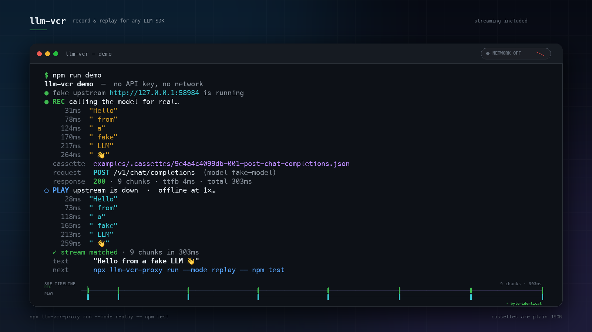

# llm-vcr

[English](README.md) · [简体中文](README.zh-CN.md)

[](LICENSE)
[](package.json)
[](package.json)

**录制并回放任意 LLM API —— 保留流式 chunk 的时间轴。**

`llm-vcr` 是一个本地 HTTP 代理。把 SDK 的 base URL 指向它一次即可：首次运行会把真实的模型响应录制为可读的 JSON cassette（录制文件）；之后每次回放都离线、确定、零成本 —— 包括 SSE chunk 之间的时间间隔。

```text
┌──────────────┐   HTTP    ┌───────────────┐   HTTPS   ┌──────────────────┐
│   你的测试    │ ────────▶ │   llm-vcr     │ ────────▶ │  OpenAI / Claude │
│   任意语言    │           │  127.0.0.1    │           │  Gemini / Ollama │
└──────────────┘           └───────┬───────┘           └──────────────────┘
                                   │ 录制一次
                                   ▼
                         cassettes/*.json
                    请求 + 响应 + 时间轴
                                   │ 永久回放
                                   ▼
                         无网络、相同字节、
                         相同 chunk 时间
```

---

## 为什么

测试 AI 功能之所以困难，原因只有一个：**模型每次返回的结果都不一样。** 这会让断言变得不稳定、CI 成本上升，也让流式 UI 几乎无法做回归测试。

现有的录制/回放工具通常是绑定某个语言的库。它们拦截 `fetch` 或 `requests`，因此只能在单一生态中使用，而且大多数会丢掉流式 chunk 之间的时间信息。`llm-vcr` 选择站在 HTTP 边界上：

- **任何语言、任何 SDK。** OpenAI、Anthropic、Gemini、Ollama、LangChain、Vercel AI SDK、原生 `curl` —— 只要能说 HTTP，就能用。
- **流式是一等公民。** 每个 SSE chunk 都会带着毫秒偏移保存。回放可以瞬时完成，也可以按真实时间播放。
- **无需修改代码。** 只需要改一个 base URL（或者让 `llm-vcr run` 自动注入）。
- **Cassette 就是 JSON。** 可以在 PR 中审查、手动编辑，并与测试一起提交。
- **失败时给出明确信息。** 未命中会返回 502，并附带最接近的 cassette 和具体差异字段。

---

## 快速开始

先用真实 API Key 录制整个测试套件：

```bash
npx llm-vcr-proxy run --mode record -- npm test
```

之后在 CI 中永久离线回放 —— 不需要 Key，也不访问网络：

```bash
npx llm-vcr-proxy run --mode replay -- npm test
```

就这样。`run` 会在一个空闲端口启动代理，注入 `OPENAI_BASE_URL`、`ANTHROPIC_BASE_URL`、`GOOGLE_GEMINI_BASE_URL` 和 `OLLAMA_HOST`，执行你的命令，然后关闭代理并等待 cassette 写入完成。

### 安装

```bash
npm install -D llm-vcr-proxy
npx llm-vcr --version
```

需要 Node 18.17+，没有运行时依赖。

如果是在仓库中直接使用：`npm install && npm link` 可以得到本地的 `llm-vcr` 命令，也可以直接运行 `node bin/llm-vcr.js`。

> **命名说明：** npm 上的 `llm-vcr` 已被另一个独立的、仅支持 Node 的 fetch 拦截库占用。本项目使用的包名是 **`llm-vcr-proxy`**；命令仍然是 `llm-vcr`，而 `npx llm-vcr-proxy` 也能运行它，因为该包只有一个可执行文件。

### 自行启动代理

```bash
# 终端 1
npx llm-vcr-proxy --mode record

# 终端 2
OPENAI_BASE_URL=http://127.0.0.1:8484/openai/v1 npm test
```

当 cassette 已存在后：

```bash
npx llm-vcr-proxy --mode replay
OPENAI_BASE_URL=http://127.0.0.1:8484/openai/v1 npm test
```

### 无需 API Key 试用

```bash
# 在仓库根目录执行
npm install
npm run demo
```

这个 demo 会启动一个假的 OpenAI 端点，录制一次流式补全，关闭上游，然后以 1× 速度从 `examples/.cassettes` 回放同一个请求。

### 演示视频

一段 18.8 秒的终端演示，基于真实运行录制：录制流式补全，关闭假上游，然后以 1× 速度离线回放 cassette。

[](demo/llm-vcr-demo.mp4)

---

## 接入你的 SDK

每个 provider 都有一个路由前缀。录制时会使用请求中的上游 API Key；回放时不再需要（并且它会在 cassette 中被脱敏）。

| Provider | 使用的 Base URL |
|---|---|
| OpenAI | `http://127.0.0.1:8484/openai/v1` |
| Anthropic | `http://127.0.0.1:8484/anthropic` |
| Google Gemini | `http://127.0.0.1:8484/google` |
| Ollama | `http://127.0.0.1:8484/ollama` |
| Groq | `http://127.0.0.1:8484/groq/v1` |
| Mistral | `http://127.0.0.1:8484/mistral/v1` |
| DeepSeek | `http://127.0.0.1:8484/deepseek` |
| OpenRouter | `http://127.0.0.1:8484/openrouter/v1` |
| Together | `http://127.0.0.1:8484/together/v1` |
| xAI | `http://127.0.0.1:8484/xai/v1` |
| Fireworks | `http://127.0.0.1:8484/fireworks/v1` |
| Perplexity | `http://127.0.0.1:8484/perplexity` |
| Cohere | `http://127.0.0.1:8484/cohere` |

转发前会去掉路由前缀。例如 `POST /openai/v1/chat/completions` 会转发到 `POST https://api.openai.com/v1/chat/completions`。没有匹配到命名前缀的路径会落到默认 target（`https://api.openai.com`，或者你用 `--target` 指定的地址）。

<details>
<summary>TypeScript / JavaScript</summary>

```ts
import OpenAI from "openai";

const client = new OpenAI({
  apiKey: process.env.OPENAI_API_KEY,
  baseURL: "http://127.0.0.1:8484/openai/v1",
});

const stream = await client.chat.completions.create({
  model: "gpt-4o-mini",
  stream: true,
  messages: [{ role: "user", content: "Hello" }],
});
```
</details>

<details>
<summary>Python</summary>

```python
from openai import OpenAI

client = OpenAI(
    api_key="sk-...",  # 仅在录制时需要
    base_url="http://127.0.0.1:8484/openai/v1",
)

stream = client.chat.completions.create(
    model="gpt-4o-mini",
    stream=True,
    messages=[{"role": "user", "content": "Hello"}],
)
for chunk in stream:
    print(chunk.choices[0].delta.content or "", end="")
```

没有 SDK？[`examples/python_client.py`](examples/python_client.py) 里有一个只使用标准库 `http.client` 的流式示例。
</details>

<details>
<summary>curl</summary>

```bash
curl -N http://127.0.0.1:8484/openai/v1/chat/completions \
  -H "authorization: Bearer $OPENAI_API_KEY" \
  -H "content-type: application/json" \
  -d '{"model":"gpt-4o-mini","stream":true,"messages":[{"role":"user","content":"Hello"}]}'
```
</details>

<details>
<summary>Azure OpenAI（自定义路由）</summary>

```json
{
  "routes": [
    { "prefix": "/azure", "target": "https://my-resource.openai.azure.com" }
  ]
}
```

把 Azure SDK 指向 `http://127.0.0.1:8484/azure`；deployment 路径会原样透传。
</details>

---

## 模式

| 模式 | 行为 | 适用场景 |
|---|---|---|
| `auto` | 匹配到 cassette 就回放，没有就录制。 | 日常开发。 |
| `record` | 始终请求上游；按出现次数原地覆盖第 N 个已有交互。 | 刷新 cassette。 |
| `replay` | 从不请求上游。未命中交互时返回 HTTP 502。 | CI、离线开发。 |
| `passthrough` | 普通代理，不录制。 | 调试代理本身。 |

`record` 是按出现次数做 **upsert**，不是清空重录。如果一个测试发起了三次相同请求，而你之前也录了三次，重新录制会覆盖这三个文件，而不会变成六个。过期的交互会保留下来，所以当某个请求从测试中消失时，请手动删除对应的 cassette（或整个目录）。

模式可以按请求覆盖：

```bash
curl ... -H "x-llm-vcr-mode: replay"
curl ... -H "x-llm-vcr-speed: 1"     # 本次请求按 1× 时间轴回放
```

---

## 流式、时间轴与 `--speed`

录制时，从上游到达的每个 chunk 都会带着 `at` 写入 cassette：自请求开始起的毫秒数。

```json
"stream": {
  "ttfbMs": 412,
  "durationMs": 2140,
  "chunks": [
    { "at": 412, "data": "data: {\"choices\":[{\"delta\":{\"content\":\"Hel\"}}]}\n\n" },
    { "at": 433, "data": "data: {\"choices\":[{\"delta\":{\"content\":\"lo\"}}]}\n\n" },
    { "at": 2140, "data": "data: [DONE]\n\n" }
  ]
}
```

回放时，相同的字符串会按相同顺序写回：

- `--speed 0`（默认）尽可能快地写入。chunk 边界会被保留，因此流式消费者仍然会读到多个 chunk。
- `--speed 1` 会等待原始的 `ttfbMs` 和 chunk 间隔。适合测试“正在输入”指示器、超时和流式 UI。
- `--speed 2` 以两倍速度回放；`0.5` 则以一半速度回放。

记录的是代理视角的实际经过时间（wall-clock），包含 DNS、TLS 和首字节时间（TTFB），不是模型内部延迟。

> TCP 可能会在传输层合并 chunk。客户端从来不能保证每个 cassette chunk 对应一次独立的 read；真实 API 也是如此。字节内容和时间轴是忠实的。

---

## 匹配

cassette 通过以下内容匹配：

1. HTTP 方法
2. 上游 origin
3. 路径（去掉路由前缀后）
4. 查询字符串（顺序无关，保留重复 key）
5. JSON body（对象 key 顺序归一化）
6. 通过 `--match-headers` 显式加入的 header

**凭证永远不参与匹配。** `authorization`、`x-api-key`、`api-key`、cookie 以及常见的 token header 都会在计算 hash 前替换为 `[REDACTED]`，所以轮换 API Key 不会让 cassette 失效。

多个完全相同的请求会按录制顺序回放。如果只录了三个相同交互，第四次调用在 `replay` 模式下会报错，在 `auto` 模式下则会产生一条新录制。

### 请求不匹配时

回放会返回 502（并带上 `x-should-retry: false`，避免 SDK 重试），响应中包含最接近的 cassette 和 body 差异：

```text
llm-vcr: no recorded response matches this request.

  POST https://api.openai.com/v1/chat/completions
  cassette dir: ./cassettes (3 interactions)

  closest match: 3f2a1c9b0d-001-post-chat-completions (86% similar)
    body.messages[0].content
      recorded: "Summarize this in one line."
      request:  "Summarize this in two lines."

  Fix: run with `--mode auto` to record this request, or re-record
       with `llm-vcr record` and commit the updated cassettes.
```

### 易变字段

有些 SDK 会追加每次都变化的请求元数据。匹配时可以忽略它（cassette 仍然会保存）：

```bash
llm-vcr --ignore-body metadata.request_id,timestamp
```

或者在配置中：

```json
{ "ignoreBodyPaths": ["metadata.request_id", "timestamp"] }
```

路径支持点号、`*` 通配符和数组下标：`messages.*.cache_control`、`messages[0].content`。

有些 header 会影响响应（例如 `anthropic-version` 或 `openai-beta`）。可以把它们显式加入匹配：

```bash
llm-vcr --match-headers anthropic-version,openai-beta
```

---

## 密钥与隐私

`llm-vcr` 面向的是要提交到 git 的 cassette：

- 凭证 header 总是替换为 `[REDACTED]`。
- 敏感查询参数（`key`、`api_key`、`token`、`signature` 等）会被脱敏。
- 看起来像凭证的环境变量（`*_API_KEY`、`*_TOKEN`、`*_SECRET`、`*_PASSWORD`）的值会自动从 body 和 header 中清除。
- 也可以添加自定义规则：

```bash
llm-vcr --scrub-env MY_CUSTOM_SECRET --scrub-pattern 'sk-[a-zA-Z0-9]{20,}'
```

> 脱敏是尽力而为。prompt 和 completion 中可能包含正则无法识别的个人数据。把 cassette 提交到共享仓库前请先审查，必要时使用私有的 cassette 目录。

---

## CI

CI 中不需要 provider key。`replay` 模式下代理不会向模型建立任何 socket。

```yaml
name: test
on: [push, pull_request]
jobs:
  test:
    runs-on: ubuntu-latest
    steps:
      - uses: actions/checkout@v4
      - uses: actions/setup-node@v4
        with:
          node-version: 20
          cache: npm
      - run: npm ci
      - run: npx llm-vcr-proxy run --mode replay -- npm test
```

有些 SDK 没有 key 就拒绝初始化；给它们一个假 key（`OPENAI_API_KEY=sk-test`）。它不会被发送到任何地方。

缺少 cassette 会让测试失败：

```text
llm-vcr: no recorded response matches this request.
```

本地刷新 cassette 时，用同样的命令加上 `--mode record`，然后提交改动后的 JSON。

### 推荐工作流

1. 对着真实 API 运行 `llm-vcr run --mode record -- npm test`。
2. 审查 `git diff cassettes/`。
3. 提交 cassette。
4. CI 使用 `--mode replay` 运行。
5. 当 prompt 合法变更时，测试会带着精确的 diff 失败；重新录制对应 cassette 并提交。

---

## CLI

```text
llm-vcr [serve] [options]             start the proxy
llm-vcr run -- <command> [args...]    start proxy, inject SDK env, run command
llm-vcr record [options]              start proxy in record mode
llm-vcr replay [options]              start proxy in replay mode
llm-vcr ls [--json]                   list cassettes
llm-vcr rm <id...> | --all --yes      delete cassettes
llm-vcr routes                        show routes
llm-vcr init                          write llm-vcr.config.json
```

| 选项 | 说明 |
|---|---|
| `-c, --cassette <dir>` | Cassette 目录（默认 `./cassettes`）。 |
| `--config <file>` | 配置文件（默认：最近的 `llm-vcr.config.json`）。 |
| `--mode <mode>` | `auto`、`record`、`replay`、`passthrough`。 |
| `--port <port>` | 默认 `8484`；`run` 未显式指定时使用空闲端口。 |
| `--host <host>` | 默认 `127.0.0.1`。 |
| `--target <url>` | 没有命名路由的路径所使用的上游。 |
| `--provider <name>` | 把已知 provider 设为默认 target。 |
| `--route <prefix=url>` | 添加/覆盖路由；可重复。 |
| `--speed <n>` | 回放速度：`0` 瞬时，`1` 真实时间。 |
| `--match-headers <a,b>` | 参与匹配的 header。 |
| `--ignore-body <a,b>` | 匹配时忽略的 JSON body 路径。 |
| `--scrub-env <VAR>` | 额外需要脱敏的环境变量；可重复。 |
| `--scrub-pattern <re>` | 额外需要脱敏的正则；可重复。 |
| `--cors` | 添加 CORS header（供浏览器客户端使用）。 |
| `--no-env` | 在 `run` 中不注入 SDK 环境变量。 |
| `--json` | `ls` 输出 JSON。 |
| `--all --yes` | 用 `rm` 删除所有 cassette。 |
| `--force` | 用 `init` 覆盖已有配置。 |
| `-q, --quiet` | 只输出警告和错误。 |
| `-v, --verbose` | 输出更多细节。 |
| `--no-color` | 禁用 ANSI 颜色。 |
| `-h, --help` | 显示帮助。 |
| `-V, --version` | 显示版本。 |

`llm-vcr ls` 会打印一张表，包含 id、method、path、status、流式 chunk 数、model、大小和距今时间。`--json` 会输出同样的数据，方便脚本处理。

`llm-vcr rm` 接受完整 id（从 `ls` 复制）、唯一的 id 前缀或 hash 前缀。删除全部 cassette 需要 `--all --yes`。

---

## 配置

在仓库中创建 `llm-vcr.config.json`（或运行 `llm-vcr init`）。相对的 `cassetteDir` 路径会以配置文件所在目录为基准解析，因此 monorepo 也能正常工作。

```json
{
  "cassetteDir": "./cassettes",
  "mode": "auto",
  "port": 8484,
  "speed": 0,
  "matchHeaders": ["anthropic-version"],
  "ignoreBodyPaths": ["metadata.request_id"],
  "maxBodyBytes": 104857600,
  "cors": false,
  "scrub": {
    "env": ["MY_CUSTOM_SECRET"],
    "patterns": ["sk-[a-zA-Z0-9]{20,}"],
    "autoScrubEnv": true
  },
  "routes": [
    { "prefix": "/openai", "target": "https://api.openai.com" },
    {
      "prefix": "/local",
      "target": "http://127.0.0.1:11434",
      "env": { "MY_LOCAL_BASE_URL": "/v1" }
    }
  ]
}
```

路由按最长前缀匹配。`/` 是 fallback。内置的 provider 路由始终可用；配置中相同 prefix 的条目会覆盖它们。

路由上的 `env` 会被 `llm-vcr run` 用来注入环境变量。值会追加到本地代理 URL 后面，因此 `{ "OPENAI_BASE_URL": "/v1" }` 会变成 `http://127.0.0.1:<port>/openai/v1`。

环境变量：`LLM_VCR_MODE`、`LLM_VCR_CASSETTE_DIR`、`LLM_VCR_PORT`、`LLM_VCR_HOST`、`LLM_VCR_SPEED`、`LLM_VCR_TARGET`、`LLM_VCR_CONFIG`、`NO_COLOR`。

---

## Cassette 格式

每次交互一个 JSON 文件，命名为 `<hash12>-<seq>-<slug>.json`。

```json
{
  "format": "llm-vcr/1",
  "meta": {
    "id": "3f2a1c9b0d-001-post-chat-completions",
    "hash": "3f2a1c9b0d…",
    "seq": 1,
    "createdAt": "2026-01-14T09:31:02.118Z",
    "provider": "openai",
    "route": "/openai",
    "status": 200,
    "model": "gpt-4o-mini",
    "stream": true,
    "chunks": 42,
    "ttfbMs": 412,
    "durationMs": 2140,
    "upstream": "https://api.openai.com/v1/chat/completions"
  },
  "request": {
    "method": "POST",
    "path": "/v1/chat/completions",
    "headers": { "authorization": "[REDACTED]", "content-type": "application/json" },
    "body": { "model": "gpt-4o-mini", "stream": true, "messages": [] },
    "bodyType": "json"
  },
  "response": {
    "status": 200,
    "headers": { "content-type": "text/event-stream" },
    "body": null,
    "bodyType": "empty",
    "stream": {
      "ttfbMs": 412,
      "durationMs": 2140,
      "chunks": [{ "at": 412, "data": "data: {...}\n\n" }]
    }
  }
}
```

JSON body 会被解析后保存，以便阅读 diff，回放时会重新序列化。SSE chunk 以原始字符串保存，脱敏后按字节回放。非 JSON 文本按 UTF-8 保存；二进制响应使用 base64。

完整 schema 和匹配算法见 [docs/cassette-format.md](docs/cassette-format.md)。

---

## 库 API

CLI 只是同一组底层原语的薄封装。

```js
import { createProxy, buildConfig } from "llm-vcr-proxy";

const config = buildConfig({
  command: "serve",
  cassette: "./cassettes",
  mode: "replay",
  port: "0",
  route: ["/openai=https://api.openai.com"],
});

const proxy = await createProxy(config);
console.log(proxy.url); // http://127.0.0.1:54321

// ... 将你的 SDK 指向 `${proxy.url}/openai/v1` ...

await proxy.close();
```

```ts
import {
  buildConfig,
  buildSignature,
  createProxy,
  CassetteStore,
  createScrubber,
} from "llm-vcr-proxy";
```

`createProxy` 返回 `{ server, port, url, store, config, counters, stats(), flush(), close() }`。`flush()` 会等待响应结束后排队的 cassette 写入完成。

---

## 对比

| | 跨语言 | 流式时间轴 | Cassette 可进 git | 无需 patch SDK |
|---|---|---|---|---|
| **llm-vcr** | ✅ HTTP 代理 | ✅ chunk 时间轴 | ✅ JSON | ✅ |
| vcrpy / pytest-recording | ❌ Python | 部分支持 | ✅ | ❌ |
| Polly.js | ❌ JS | 部分支持 | ✅ | ❌ |
| `llm-vcr`（npm fetch 拦截器） | ❌ Node | ❌ | ✅ | ✅ |
| WireMock / MockServer | ✅ | 仅请求级 | ✅ | ✅ 但需要手写 stub |

`llm-vcr` 刻意不是 mock server。你不需要描述模型“应该”说什么；只需要录制它实际说过的一次，然后回放。

---

## 限制

- **它是反向代理，不是 HTTPS MITM 代理。** 需要把 SDK 的 base URL 指向它；只设置 `HTTPS_PROXY` 不行，因为那需要可信证书。这是让配置保持一行的取舍。
- 上游仅支持 HTTP/1.1。主流 LLM API 都支持。
- JSON 响应会被归一化（解析后重新序列化）。SSE 字节在脱敏后保持精确。如果需要 JSON 格式也字节一致，可以通过自定义路由把它当作文本存储，或者直接断言解析后的对象。
- WebSocket upgrade 会以 426 拒绝。
- 图片/音频 payload 会让 cassette 变大（base64）。`maxBodyBytes` 默认 100 MB。
- 脱敏是尽力而为；prompt 中可能包含 PII。
- 并发的相同请求会通过按 hash 的写锁录制，但回放游标是有意串行的。

---

## 路线图

- **团队 cassette registry** —— 共享库，从 CI 拉取/推送 cassette，在 UI 中审查 diff。
- 面向并行测试运行器的 per-test cassette 作用域。
- `llm-vcr inspect` —— 本地 HTML 时间轴查看器。
- 为每次回放交互生成 OpenTelemetry span。
- 用于脱敏复杂 payload 的请求/响应 transform。

核心采用 MIT 许可且无依赖。托管 registry 是项目持续获得资金的方式。

---

## 开发

```bash
npm install       # 或 pnpm install
npm test          # node:test，不访问网络
npm run typecheck
npm run demo      # 假上游，录制 + 回放
```

需要 Node 18.17+。运行时无依赖。

---

## 贡献

欢迎贡献。开发环境、测试、cassette 规则和 PR 检查清单见 [CONTRIBUTING.md](CONTRIBUTING.md)。安全问题请按照 [SECURITY.md](SECURITY.md) 私下报告。

## 许可证

MIT
